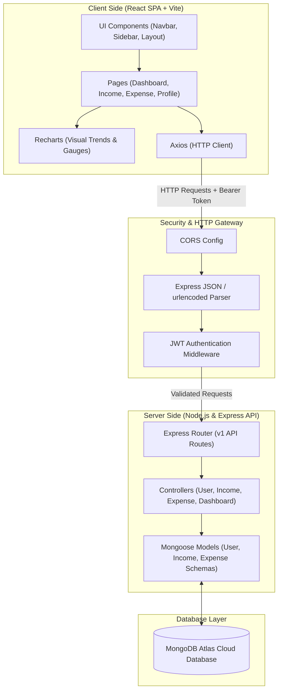
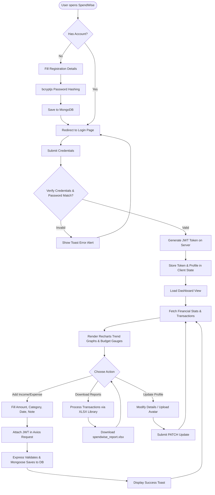

# 💰 SpendWise — Premium Personal Expense Tracker

SpendWise is a state-of-the-art, secure, and modern Personal Expense Tracker built on the **MERN (MongoDB, Express, React, Node.js)** stack. Featuring a highly responsive dashboard, fluid animations, custom data visualizations, and professional financial reporting, SpendWise empowers users to take full control of their personal finance.

---

## 📌 1. Problem Statement

In today's fast-paced digital economy, tracking personal income and day-to-day expenditures has become increasingly complex. Many individuals suffer from a lack of financial clarity due to:
* **Manual Tracking Overhead:** Documenting expenditures in paper-based ledgers or basic spreadsheets is tedious and prone to human error.
* **Absence of Real-Time Analytics:** Basic logs do not show where money is flowing in real time, making it hard to identify immediate financial drains.
* **Lack of Actionable Insights:** Without visual comparisons (e.g., income-vs-expense charts, budget-to-actual gauges), it is difficult to maintain budgeting discipline.
* **Security & Privacy Risks:** Storing private financial information in unencrypted formats exposes sensitive data to unauthorized third parties.

**SpendWise** addresses these issues by offering a secure, intuitive, and visually stunning digital ledger that processes real-time transaction updates, represents trends graphically, evaluates budget limits dynamically, and exports audited spreadsheets seamlessly.

---

## 🎯 2. Objectives

The primary objectives of the SpendWise platform are:
1. **Secure User Access:** Implement robust, token-based authentication using **JSON Web Tokens (JWT)** and secure **bcryptjs** password hashing to safeguard private financial records.
2. **Dynamic Dashboard Analytics:** Enable instant financial awareness through responsive bar, area, and pie charts using **Recharts**, coupled with visual budget indicators.
3. **Comprehensive Financial Ledger (CRUD):** Facilitate smooth tracking, modification, and categorization of both income streams and expense categories with precise timestamps.
4. **Data Portability:** Enable offline analysis and physical backups by allowing users to download comprehensive financial sheets via **Excel (.xlsx)** exports.
5. **Fluid, Premium User Experience:** Design an interactive front-end with Tailwind CSS v4 and Framer Motion, offering smooth glassmorphic designs, micro-interactions, and responsive layouts for desktop and mobile.

---

## 🛠️ 3. Tech Stack

SpendWise utilizes a robust collection of modern technologies divided across its stack:

### Frontend
| Component | Technology | Description / Usage |
| :--- | :--- | :--- |
| **Framework** | React 19 + Vite | High-speed Single Page Application development with Hot Module Replacement (HMR). |
| **Styling** | Tailwind CSS v4 | Modern, utility-first design engine for premium glassmorphic UI. |
| **Navigation** | React Router DOM v7 | Standard routing for separate pages (Dashboard, Income, Expenses, Profile). |
| **Data Viz** | Recharts v3 | Renders gorgeous, responsive area charts, category pie charts, and budget-health gauges. |
| **Animations** | Framer Motion v12 | Controls micro-animations, slide-overs, dynamic menu expansions, and page transitions. |
| **Exports** | SheetJS (`xlsx`) | Generates well-formatted Excel spreadsheet files on the client-side for offline auditing. |
| **Client Core** | Axios | Promised-based HTTP communications with backend APIs. |
| **Iconography** | Lucide React | Clean, scalable vector outline icons for a minimal modern look. |

### Backend & Database
| Component | Technology | Description / Usage |
| :--- | :--- | :--- |
| **Runtime** | Node.js | Fast, scalable, non-blocking asynchronous event-driven JavaScript runtime. |
| **Web Framework** | Express.js | Standard, minimal REST API framework for routing, middlewares, and controllers. |
| **Database** | MongoDB | NoSQL Document-based database for flexible schemas and lightning-fast queries. |
| **ORM** | Mongoose | Object Relational Mapping library for structured schemas, relationships, and validation. |
| **Security** | bcryptjs + JWT | Secures passwords via salt-hashing, and authorizes requests using signed JSON Web Tokens. |
| **Dev Tooling** | Nodemon | Hot-reloads the Express server during backend development. |

---

## 📐 4. Architecture Diagram

The system follows a clean client-server architecture with secure API endpoints and schema validations:



---

## 📈 5. Methodology Diagram

The flow below represents the end-to-end user lifecycle and operational workflow of the application:



---

## 🚀 6. Getting Started

Follow these steps to set up and run SpendWise locally:

### Prerequisites
* **Node.js** (v16.x or higher)
* **MongoDB** (Local instance or MongoDB Atlas account URI)

### Backend Setup

1. Navigate to the backend directory:
   ```bash
   cd backend
   ```
2. Install the server dependencies:
   ```bash
   npm install
   ```
3. Start the development server (runs via Nodemon):
   ```bash
   npm run dev
   ```

### Frontend Setup

1. Navigate to the frontend directory:
   ```bash
   cd ../frontend
   ```
2. Install client dependencies:
   ```bash
   npm install
   ```
3. Start the Vite development server:
   ```bash
   npm run dev
   ```
4. Open [http://localhost:5173](http://localhost:5173) in your browser.

> [!NOTE]
> Ensure both the backend and frontend are running concurrently to allow successful API communication.

---

## 📄 License
This project is open-source and available under the MIT License.
